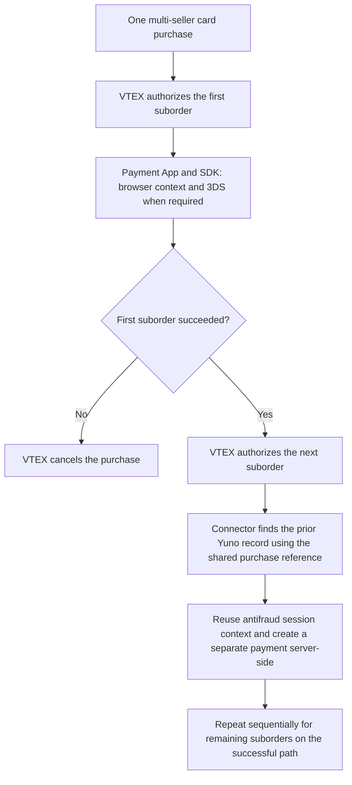

# Multi-seller card payments on VTEX — source notes

## Status and sources

Editorial source material supporting the published contribution. The owner has
supplied the problem, connector ownership, solution, development validation and
merchant outcome, including sequential processing, session lookup and the division
of responsibility for 3DS. Public records live in `content/contributions/en.ts`
and `es.ts`, using the identifier `vtex-split-orders`.

Hugo's firsthand account establishes his implementation and the historical
limitation. Public documentation supplies product context, not independent
evidence of authorship or of the exact behavior during his implementation.

- [Yuno split orders](https://docs.y.uno/docs/plugins/vtex/advanced-features#split-orders-multiple-sellers):
  describes independent suborder authorization and a shared antifraud session.
  Current provider configuration and version-specific behavior must not be
  attributed to Hugo's delivery without confirmation.
- [Yuno antifraud session](https://docs.y.uno/docs/plugins/vtex/advanced-features#antifraud-session-device-fingerprints):
  explains how a shared session identifier links browser-collected device data
  to the payment's antifraud context. It documents `orderFormId` as that identifier.
- [VTEX Payment App](https://developers.vtex.com/docs/guides/payments-integration-payment-app):
  explains the connector-to-checkout application flow, including browser
  interactions such as a 3DS challenge. Case-specific constraints come from Hugo.

## Central story and scope

A major Brazilian marketplace needed Yuno's VTEX plugin to process card purchases
containing products from multiple sellers. VTEX authorized their suborders
separately and sequentially. The integration could process the first through its
browser-based Payment App, but could not process later suborders through that
same path.

Hugo designed and implemented the Payment Connector changes to share the first
suborder's antifraud session with related suborders and process their payments
server-side. This removed an integration blocker for the requesting marketplace
and expanded the plugin's suitability for other marketplace merchants.

The supplied scope is card payments in this integration. Do not generalize the
account into a rule about every VTEX payment method or marketplace topology.
Separate seller suborders and payments are the topic; distributing a single
payment's proceeds among recipients has not been described.

## Before and after

### Existing card flow and limitation

1. The shopper entered card details in the VTEX payment step and clicked Pay.
2. VTEX initiated authorization and called Yuno's Payment Connector.
3. The connector requested Yuno's Payment App. It initialized the SDK and
   provided the browser context needed for antifraud collection and, when
   applicable, 3DS interaction before completing payment processing.
4. VTEX handled the resulting status and checkout navigation.

For the multi-seller scenario, VTEX issued a separate authorization for each
suborder, one after another rather than in parallel. In Hugo's account, only the
first could follow the Payment App flow; later authorizations arrived in seller
accounts where it could not be reopened.
The connector lacked a server-side path carrying the required antifraud context.
As a result, the later suborders could not be processed and were cancelled.

The Payment App's embedded-versus-external presentation is background, not the
problem this contribution solved. The relevant constraint is its availability
for subsequent authorizations and the browser context needed by the integration.

### Implemented change

1. Before processing an order, the connector looked for an existing Yuno record
   associated with the purchase reference.
2. The first suborder used the Payment App/SDK browser path, supplying antifraud
   session context and handling 3DS when required.
3. If the first suborder failed, VTEX cancelled the entire purchase. It did not
   continue with subsequent suborders in that scenario.
4. After the first succeeded, VTEX authorized later suborders sequentially. Their
   shared purchase reference allowed the connector to find the existing Yuno
   information and reuse the antifraud session context.
5. The connector created those subsequent payments server-side without reopening
   the Payment App. Each suborder still involved a separate payment; shared
   context is not a guarantee that every payment will be approved.

### Session data and purchase correlation

The shared data is the session identifier that associates device information
collected in the browser with the antifraud context sent for a payment. The
referenced documentation uses the cart's `orderFormId` consistently on the
browser and connector sides. This is not copying an approval verdict from the
first payment to the others.

Hugo describes suborders as sharing a base `orderId` reference and having suffixes
such as `-01`, `-02` and `-0n`. The connector used that shared reference to locate
information already associated with the purchase in Yuno. Distinguish this
lookup reference from `orderFormId`, the documented antifraud session identifier;
do not treat the two identifiers as interchangeable or infer an exact API field
name for the base reference. Public copy can use "shared purchase reference."

### 3DS responsibility and scope

Hugo confirms that 3DS, when applicable, ran once on the first suborder. For the
related suborders paid with the same card, Yuno internally handled the flow
without requiring the shopper to repeat it. His connector work made the session
context available for later payments; it was not a newly implemented 3DS engine.
Keep this behavior specific to the described integration and purchase, without
generalizing it into a rule for unrelated payments using the same card.

No exact storage, retry, timeout or idempotency implementation has been supplied.
The outcome when a later suborder fails has not been described; do not infer
rollback or cancellation behavior for already-processed sibling payments.

## Ownership, validation and value

Hugo identified the missing antifraud-context handoff and implemented the
connector changes in full. The requirement came from a merchant; authorship of
the existing Payment App, SDK, VTEX platform or public documentation is not
established by this case. No new frontend implementation has been reported.

He configured a Yuno VTEX development store with its own products and products
from a test seller in a separate development account. He tested the multi-seller
purchase, checked that suborders shared the antifraud session and verified that
the PSP did not decline them because that context was missing. Do not infer
automated coverage, particular log tooling or exhaustive provider/device tests.

The owner reports that the delivery enabled the requesting marketplace's
transaction traffic to move to Yuno. It also made the plugin a viable option for
future merchants using that model. No transaction volume, revenue figure or
additional merchant adoption count has been supplied. Keep the requesting
merchant unnamed, as no public identification has been supplied.

## Public narrative

**Title:** Card payments for multi-seller VTEX orders.

**Overview:** I designed and implemented Payment Connector support for multi-seller
card purchases on VTEX. By sharing antifraud session context across related
suborders, the integration could process subsequent payments server-side when
the checkout's Payment App could not run again.

**Value:** The delivery unblocked a Brazilian marketplace's migration of payment
traffic to Yuno and extended the integration to support other merchants operating
with multiple sellers.

Visible capabilities can cover purchase correlation with shared session context
and server-side processing of subsequent suborders. Explain the sequential flow,
original browser constraint, Yuno-managed 3DS, first-suborder failure behavior
and test setup in expandable detail. Do not imply that fraud screening or 3DS
was bypassed.

## Supporting visual

Use a conceptual diagram of the sequential browser and server paths, rather than
fabricated screenshots or logs. Make the first-suborder outcome explicit and
show subsequent suborders as a repeated sequential step, not a parallel fan-out.

A short before/after comparison is optional if it makes the blocker clearer;
avoid repeating the same flow in two overview visuals. No screenshot gallery
is needed for this backend contribution. Reuse the existing diagram components
for the public presentation.

## Public presentation

The case is the third visible contribution. Its overview includes connector
ownership and marketplace value; two visible capabilities explain shared context
and server-side processing. The generic stage/node diagram presents the successful
sequential path and states the first-suborder cancellation condition in its caption.
Expandable details cover the original limitation, session correlation, 3DS and
development validation. Supporting documentation opens in a new tab. A screenshot
gallery is unnecessary for this service-side change.
