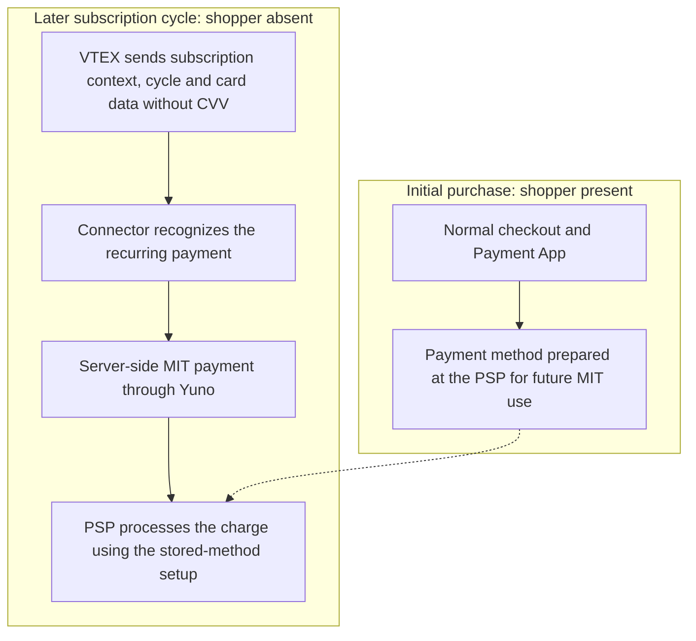

# VTEX subscription payments — source notes

## Status and sources

Editorial source material supporting the integrated contribution. The
owner supplied the problem, connector responsibility, development validation,
merchant outcome, recurring-order detection and preparation of the first payment
for subsequent MIT charges. Public records live in `content/contributions/en.ts`
and `es.ts`, using the identifier `vtex-subscriptions`.

The owner's firsthand account establishes his contribution and the historical
limitation. Current public documentation explains supported product behavior;
it does not establish which internal changes he implemented.

- [VTEX subscription behavior](https://help.vtex.com/docs/tutorials/how-subscriptions-work):
  explains how VTEX schedules repeat orders at the shopper's chosen frequency.
- [Yuno recurring-payment FAQ](https://docs.y.uno/docs/plugins/vtex/faqs#does-yuno-support-vtex-subscriptions-recurring-payments):
  describes an ordinary first card purchase followed by stored-credential,
  merchant-initiated (MIT) renewals without the shopper present or a new CVV.
  Current documentation says no extra Yuno configuration is required; confirm
  historical implementation details before attributing them to this delivery.

## Central story and scope

A merchant already using VTEX Subscriptions moved to Yuno and found that its
recurring orders were not processing correctly and were being cancelled. The
first purchase worked through the existing card-payment flow, but subsequent
orders had neither a shopper browser session nor a CVV in the VTEX authorization
request. They required a server-side payment path.

Hugo was responsible for adding subscription support in Yuno's Payment Connector.
The resulting integration resolved the requesting merchant's problem and added
recurring card-payment support to the plugin's offering for other merchants.

The case concerns card payments for scheduled VTEX orders. The connector
integration is Hugo's contribution; VTEX supplies subscription plans, order
scheduling and recurrence. Do not attribute a new subscription engine to him.

## Before and after

### Initial purchase

1. The shopper selected subscription-enabled products and their recurrence.
2. The shopper entered card details and completed the normal checkout flow.
3. VTEX called the connector, and the Payment App/SDK processed the first card
   payment as in the previously documented integration.
4. The integration instructed Yuno/the PSP to store the payment method for later
   MIT transactions. The owner locates the retained reference specifically at the
   PSP. No particular token type, payload field or storage API was supplied.

The normal first-payment processing already worked. Subscription support added
the preparation needed for later charges without changing the shopper's normal
initial checkout experience.

### Subsequent cycles and implemented support

1. VTEX generated an order at the configured recurrence without the shopper
   actively visiting checkout.
2. VTEX requested payment authorization from the connector. The owner's account
   says other card data was supplied, but the CVV was omitted.
3. The connector used the subscription context and recurrence information to
   recognize the appropriate payment flow.
4. It sent the subsequent payment through the server-side stored-credential MIT
   path. Card data continued to be supplied without CVV; the PSP's stored-method
   setup allowed that recurring payment to be processed.
5. In the owner's account, the later charge required neither a new shopper
   browser interaction nor another browser-based antifraud validation.

### Detecting subscription cycles

The VTEX authorization data included `interaction` with the value `subscription`.
VTEX also supplied the cycle number. Hugo identifies cycle 0 as the first
recurring order after the initial purchase, with later cycles incrementing it;
do not relabel the initial checkout purchase as cycle 0.

The absence of CVV in card data was an additional recurrence signal in this
integration. Explain these indicators together within the VTEX subscription
context, rather than making a universal rule that every payment without CVV is
a subscription. Exact cycle-field names or detection precedence were not given.

### Stored-method responsibility

The initial payment prepared the payment method at Yuno/the PSP for future MIT
use. Later authorizations still carried card data, without CVV. Do not replace
that account with a claimed connector-side token-only request, reference lookup
API or local card vault; those mechanics have not been established.

The account describes recurring charges proceeding without another browser-side
antifraud step. Keep that statement within this configured MIT integration;
it does not establish that a PSP performs no internal risk checks or that all
MIT payments are guaranteed approval. This case does not describe reusing the
initial antifraud session or 3DS result across cycles.

## Ownership and decisions

Hugo implemented subscription support in the Payment Connector: recognizing the
VTEX subscription/cycle information, preparing the first payment for future
stored-method use and processing subsequent payments through the MIT path.
VTEX supplied recurrence scheduling and authorization metadata; Yuno and the PSP
supplied stored-credential processing. No Payment App, SDK or subscription
scheduling changes were reported.

The absence of the shopper and CVV made a server-side recurring path necessary.
The problem affected a merchant that had already migrated, making delivery
urgent. No exact implementation duration or evaluated alternatives were supplied.

## Validation and observed value

Hugo enabled Subscriptions in Yuno's VTEX development account, created plans and
associated them with products. In the test storefront, he added products,
selected subscription options and recurrence, and exercised the initial purchase.

To validate later cycles without waiting for the scheduled interval, he triggered
the recurring orders through VTEX APIs and checked that payments were created
correctly on the server. Do not name an endpoint, automated suite or additional
failure scenario that the account does not establish.

The owner reports that the development resolved the requesting merchant's
subscription-payment problem. The plugin could then offer subscription support
to existing and prospective merchants. Distinguish that expanded capability from
confirmed adoption by additional merchants or measured revenue improvement.
No numerical metrics or permission to identify the merchant were supplied.

## Public narrative

**Title:** Recurring card payments for VTEX subscriptions.

**Overview:** I implemented Payment Connector support for VTEX subscriptions,
preparing the initial card purchase for future use and recognizing subsequent
subscription cycles. Renewals could then be processed server-side as
merchant-initiated payments when the shopper was absent and VTEX did not supply
a CVV.

**Value:** The delivery resolved subscription-order processing failures for a
merchant that had moved to Yuno and expanded the plugin's capabilities for
existing and prospective merchants with recurring purchases.

Visible capabilities can explain preparation of the payment method for future
charges and recurring-cycle recognition with server-side MIT processing. Expand
the initial-versus-recurring flow, implementation decisions and API-triggered
validation in the details. Keep `interaction`, cycle numbering and CVV signals
in technical detail rather than the overview. Avoid forcing a fixed capability
count or duplicating the complete normal card flow from earlier cases.

## Supporting visual

A two-phase diagram can distinguish the initial shopper-present purchase and PSP
preparation from scheduled renewals. It should show who stores the reference
without inventing a connector lookup or the format of the stored credential.

## Public presentation

The case is the fourth visible entry, linked from the contribution index. Its two-phase overview reuses `ContributionComparison` to distinguish
the initial purchase and later cycles. Two capabilities cover preparation for
future charges and recurring-order recognition with server-side processing.
Technical disclosures explain detection, PSP responsibility and API-triggered
validation. Source links open in separate tabs. Direct case anchors reach the visible overview, including without JavaScript.
The language control preserves the case fragment when JavaScript is available.

Keep unspecified payload fields, retry behavior and provider risk internals out
of public claims; those details are not needed to explain the contribution.
