# Direct wallet checkout on VTEX — source notes

## Status and sources

Editorial source material, not rendered directly by the portfolio. The owner has supplied
the problem, solution, validation, observed adoption, five screenshots and the
implementation details needed to establish ownership and payment sequencing.
The bilingual public records are integrated in `content/contributions/en.ts` and
`es.ts`, using the identifier `wallet-enhanced-experience`.

The owner's firsthand account establishes personal participation and historical
behavior. Current public documentation supports product context and functionality;
it does not independently establish authorship or which features existed during
the owner's implementation.

- [VTEX Payment App guide](https://developers.vtex.com/docs/guides/payments-integration-payment-app):
  explains the embedded payment-app integration model and its transaction flow.
- [Yuno wallet enhanced experience](https://docs.y.uno/docs/plugins/vtex/apple-pay-google-pay-enhanced-experience):
  documents the optional direct wallet experience, merchant setup and installments.
- [Yuno headless SDK integration](https://docs.y.uno/docs/plugins/vtex/direct-sdk-integration):
  describes an adjacent integration option. It is not proof that the wallet
  extension and that SDK share an identical sequence or implementation.
- [Yuno Web SDK examples](https://github.com/yuno-payments/yuno-sdk-web):
  distinguish generation of a one-time token from the subsequent backend payment
  creation. The case-specific VBase handoff comes from the owner's account.
- [VTEX native clients](https://developers.vtex.com/docs/guides/vtex-io-documentation-clients):
  documents the platform's VBase access client, including storage and retrieval.

The contribution includes the initial direct wallet flow and the subsequent
installment phase. Hugo confirmed that he developed the solution integrally,
including the Payment Connector changes and installment support. Present those
phases as parts of the same contribution without implying they shipped together.

## Central story

Product wanted a smoother wallet-payment experience, but the team did not have
a clear implementation path within VTEX's controlled checkout. Hugo drew on prior
checkout-customization experience at ITGlobers to design and implement a checkout
extension that brought wallet interaction directly into the payment step. He also
implemented the supporting Payment Connector changes and endpoints and later
extended the solution with installments.

The case combines user-experience work with integration design: remove an
intermediate Payment App interaction, coordinate with VTEX authorization, preserve
the existing integration for merchants that do not opt in, and make supporting
integration capabilities reusable beyond the native checkout.

## Problem and affected users

Shoppers paying with Apple Pay, Google Pay or Samsung Pay encountered two separate
payment-launch actions: VTEX's generic pay button, then a wallet-specific button
inside Yuno's Payment App. The second step made the experience feel fragmented.

The Payment App was created and maintained by Yuno and ran within VTEX's checkout
infrastructure. The old flow already kept shoppers inside checkout; removing an
external redirect was not the contribution.

| Audience | Need |
| --- | --- |
| Shoppers | Reach the wallet experience directly from the checkout payment step. |
| Merchants using native VTEX checkout | Adopt the improved flow through configuration while retaining the existing integration if they choose not to enable it. |
| Yuno Product and Engineering | Offer a more attractive wallet integration within platform constraints. |
| Merchants with custom frontends or mobile applications | Reuse supporting integration capabilities while controlling their own interface. |

## Original flow, from the owner's account

1. The shopper selected a wallet in the native VTEX checkout payment step.
2. The shopper clicked VTEX's generic pay button.
3. VTEX initiated its order-authorization flow and called Yuno's Payment Connector.
   The connector returned the information required to open Yuno's Payment App.
4. The Payment App loaded and initialized the existing Yuno payment SDK for the
   selected wallet, which displayed another pay button.
5. The shopper clicked that wallet button to open the wallet's payment experience,
   such as a popup or native sheet, and completed the required interaction.
6. An unsuccessful payment returned the shopper to the payment step with an error;
   a successful payment led to the Order Placed page.

## Enhanced flow, from the owner's account

1. The injected checkout application detected selection of a supported wallet.
2. It hid VTEX's generic pay button and mounted the selected wallet's button in
   that method's description area within the payment step.
3. Clicking that button opened the wallet experience directly, where the shopper
   completed the required interaction. The application used Yuno's SDK underneath.
4. Completing that interaction generated a One Time Token (OTT), used to create
   the payment. No payment had been created yet.
5. The application sent the OTT to the Payment Connector, which stored it in VBase
   for retrieval during authorization.
6. The application programmatically initiated the VTEX authorization phase, which
   invoked the Payment Connector.
7. The connector retrieved the OTT from VBase, created the payment in Yuno using
   it and returned the resulting status to VTEX.
8. Rejected payments kept the shopper in the payment step; successful payments
   proceeded to Order Placed.

Token generation and payment creation are distinct stages. The custom application
brought wallet interaction forward in the checkout, while actual payment creation
remained inside the connector's handling of VTEX authorization. VBase bridged
those two stages by holding the OTT until the connector needed it.

Describe this as a token-based handoff. The account does not establish particular
VBase retention, cleanup, encryption or token-expiry mechanisms; do not invent
them or turn token use into a blanket compliance/certification claim.

"One click" describes a single checkout action to launch the wallet experience.
It is not a claim that the entire purchase, including wallet confirmation, takes
one click or that wallet authentication is bypassed.

## Ownership and collaboration

| Part | Established participation |
| --- | --- |
| Product objective | Product initiated the request to improve the wallet experience. |
| Implementation approach | Hugo identified a viable checkout-customization approach using his prior VTEX experience. |
| Injected application | Hugo created the application, detected wallet selection, controlled button placement and coordinated the enhanced flow. |
| Checkout core and wallet experience | Supplied by VTEX and the respective wallet integrations, rather than authored by Hugo. |
| Payment Connector changes and endpoints | Hugo implemented the supporting changes and endpoints, including the OTT storage/retrieval handoff and payment creation during VTEX authorization. |
| Installment support | Hugo implemented the changes required to support installments in a subsequent phase of the same contribution. |
| Headless/mobile interfaces | Merchants could implement their own interfaces using supporting capabilities; do not attribute their applications or entire integrations to Hugo. |
| Public documentation | Supplied as a reference; authorship of those pages has not been established. |

This was a Product-driven improvement with an end-to-end technical solution
implemented by Hugo. Credit his frontend and connector work while preserving
the distinction between his integration, Yuno's existing SDK and VTEX's platform.

## Complete capability inventory

### Direct wallet entry inside native checkout

The extension replaced the generic checkout action with a wallet-specific button
when an eligible payment method was selected. It removed the intermediate Payment
App interaction from this path while keeping the platform's final status flow.
Wallet coverage in the account includes Apple Pay, Google Pay and Samsung Pay.

The new application used Yuno's SDK internally. Public copy should focus on the
removed Payment App screen and direct wallet experience rather than claiming
that the SDK itself was eliminated. The owner's analogy between this application
and the Payment App is explanatory context, not wording to reproduce literally.

### Payment handoff through the connector

Hugo implemented the connector changes needed to receive and store the OTT,
retrieve it when VTEX authorization ran and create the payment at that point.
This is an integration contribution spanning the checkout application and its
backend, not only a visual replacement of a button.

### Optional adoption and compatibility

Merchants enabled the new flow through a small checkout configuration. It did not
replace the legacy experience for every store. Stores retaining their existing
configuration could continue using the Payment App flow.

This is opt-in compatibility across merchant configurations, not a confirmed claim
of automatic runtime fallback for every unsupported browser, device or wallet.

### Wallet installments

The initial delivery provided direct wallet buttons. In a subsequent phase, Hugo
implemented the changes needed to offer installment payments through the enhanced
flow, a capability absent from the earlier experience. Both phases belong to this
contribution. The supplied screenshots show installment selection and financing
information; keep the public explanation concise and do not imply simultaneous
delivery of the buttons and installment features.

### Reusable integration foundations

Hugo's Payment Connector changes and exposed endpoints also enabled use in
VTEX headless scenarios. Merchants with mobile applications could integrate with
VTEX APIs and control their own UI, rather than inject the native-checkout script.

Present this as reuse enabled by supporting integration work. Do not imply Hugo
built every merchant application, that the injected browser script itself runs
as native mobile UI, or that the adjacent headless SDK guide necessarily documents
these exact wallet endpoints.

## Decisions and constraints

| Decision | Reason and scope |
| --- | --- |
| Use checkout-script customization | The team could not directly change VTEX's checkout core through its plugin. Hugo identified an available extension path. |
| Render the selected wallet's button in its payment-method area | Bring wallet interaction to the shopper's existing checkout context and remove the second launch step. |
| Bridge wallet interaction and VTEX authorization through the OTT | Store the generated token in VBase and create the payment only when the connector processes VTEX authorization, keeping the new interaction aligned with the platform flow. |
| Offer opt-in merchant setup | Allow adoption without forcing every existing merchant onto a different interaction. |
| Support integration through connector capabilities | Extend usefulness beyond the injected native-checkout UI to merchant-controlled frontends. Hugo implemented those supporting changes and endpoints. |
| Extend the solution with installments in a later phase | Evolve the direct wallet experience with an additional payment capability while keeping both deliveries within the same contribution. |

The old Payment App was itself a Yuno application within VTEX. The constraint was
control of the checkout core and payment sequence, not an inability to develop
any custom application on the platform.

## Validation

The solution was tested in Yuno's VTEX development account across the different
wallets, including approved payments, rejected payments and error scenarios.

During development, logs were added and reviewed in Datadog to trace data through
the flow, locate errors and understand the integration's behavior. The account
does not specify an automated test suite, exhaustive device coverage or measured
latency improvements; do not infer those from development testing.

## Observed value and claim boundaries

| Value | Available basis | Public treatment |
| --- | --- | --- |
| A less fragmented wallet experience | Removal of the intermediate Payment App button step | Describe the concrete interaction change, without a conversion percentage. |
| An additional merchant integration option | Product delivery and positive merchant reception reported by Hugo | Describe the new option without implying a separate paid product or measured revenue. |
| Adoption by some merchants | Owner reports that some merchants migrated to the enhanced flow | Qualitative adoption is valid; do not invent merchant counts or names. |
| Installment functionality | Owner confirms implementing support in a subsequent phase; screenshots and public guide illustrate it | Attribute the implementation to Hugo while preserving the delivery sequence. |
| Extensibility to headless/mobile use | Owner describes reuse of supporting connector capabilities by merchants | Credit the enabling work without claiming authorship of merchant UIs. |
| Conversion, completion rate, latency or revenue improvement | No measurements supplied | Omit numerical or causal business-performance claims. |

The value statement should cover shoppers, merchants and Yuno: a more direct
interaction, an attractive optional integration, and reusable capabilities for
different merchant architectures.

## Candidate public overview for review

**Working title:** Direct wallet payments inside VTEX checkout.

**Summary:** I designed and implemented the checkout application and Payment
Connector changes that opened Apple Pay, Google Pay and Samsung Pay directly from
VTEX's payment step, removing an intermediate Payment App interaction. I connected
wallet tokenization to VTEX authorization, preserved opt-in adoption and later
added installment support. The connector capabilities also enabled reuse by
merchants with custom frontends and mobile applications.

**Team and business value:** Shoppers gained a more direct wallet experience,
and merchants gained an optional integration that some chose to adopt. Supporting
connector capabilities also opened a path for merchant-controlled checkout and
mobile interfaces, extending the value beyond the native VTEX checkout.

This narrative supports the English/Spanish public records. The core ownership,
processing and delivery-scope questions are resolved. Keep these editorial notes
separate from the visible case text.

## Supplied visual material

The five AVIF files are readable. They were inspected through a browser; the
originals remain unchanged. Source directory supplied by the owner:
`/mnt/c/Users/ASUS/Downloads/enhance-wallets`.

| Filename | Intrinsic dimensions | Visible content |
| --- | --- | --- |
| `google-pay-1.avif` | 684 × 323 | Google Pay selected, with its payment button inside the checkout method area. |
| `apple-pay-1.avif` | 1364 × 762 | Apple Pay button and collapsed installment selector within checkout. |
| `apple-pay-2.avif` | 1364 × 1042 | Expanded Apple Pay installment options. |
| `apple-pay-3.avif` | 1364 × 990 | Selected Apple Pay installment plan and financing breakdown. |
| `samsung-pay-1.avif` | 693 × 714 | Samsung Pay payment button, installment selection and financing details. |

The screenshots use Portuguese UI text. Preserve the real interface and add
English/Spanish captions and alternative text when integrating them. There is no
need to recreate screenshots or translate their pixels.

The local files do not show the original Payment App flow. A clearly labelled
conceptual comparison can explain that sequence without fabricating a screenshot.

## Explanatory visuals

1. **Before/after interaction diagram:** show the extra generic-pay/Payment App
   step in the original path and direct wallet entry in the enhanced path. Keep
   wallet interaction separate from final VTEX status confirmation.
2. **Actual checkout screenshots:** use the Google Pay example for direct entry
   and an Apple Pay installment image for the additional capability. Samsung Pay
   can supplement the explanation when useful; avoid displaying all three Apple
   Pay states by default if they repeat the same point.
3. **Native versus merchant-controlled integration:** if useful, show the shared
   connector capabilities serving the native checkout extension and a merchant's
   custom frontend. This is an architecture explanation, not a screenshot of a
   merchant mobile application.

### Interaction comparison

This follows the owner's confirmed interaction and payment-creation sequence.
The enhanced path separates the shopper's wallet interaction, token storage and
payment creation during VTEX authorization.

```mermaid
flowchart TB
    subgraph Original["Original checkout path"]
        A["Select wallet"] --> B["Click generic VTEX pay button"]
        B --> C["VTEX authorization calls Yuno connector"]
        C --> D["Yuno Payment App loads payment SDK"]
        D --> E["Click wallet-specific pay button"]
        E --> F["Complete wallet interaction"]
        F --> G["Final checkout status and navigation"]
    end
    subgraph Enhanced["Enhanced checkout path"]
        H["Select wallet"] --> I["Click wallet button inside checkout"]
        I --> J["Complete wallet interaction"]
        J --> K["Yuno SDK generates OTT"]
        K --> L["Connector stores OTT in VBase"]
        L --> M["Run VTEX authorization"]
        M --> N["Connector retrieves OTT"]
        N --> O["Create payment in Yuno"]
        O --> P["Return status to VTEX and navigate"]
    end
```

## Public presentation

The integrated case covers the problem, end-to-end ownership, payment sequence,
opt-in compatibility, later installment support, validation, merchant adoption
and reuse in other architectures.

The public presentation makes the frontend and connector work legible without
requiring every reader to understand OTT or VBase. The before/after shopper
journey is visible in the overview; the token/authorization sequence is inside
expandable technical detail. Three unchanged AVIF images are served from
`public/images/contributions/wallet-checkout/`, showing Google Pay direct entry,
Apple Pay installment details and Samsung Pay. Each has localized captions,
alternative text and full-size access through the shared modal, with native
image links available without JavaScript. Supporting documentation opens in
a new tab and preserves the portfolio page.
