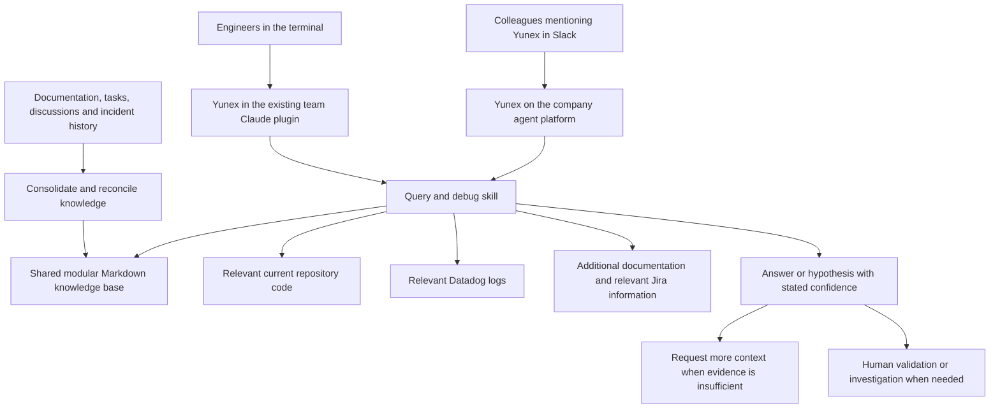
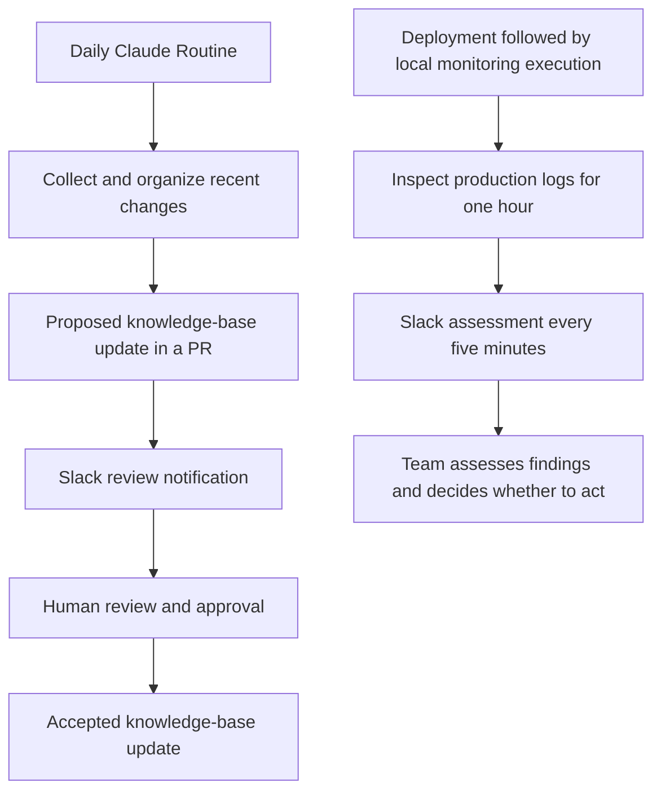

# Yunex — professional contribution draft

## Status and source

Editorial working material supporting the portfolio case. Based on Hugo's
firsthand account; original code, screenshots, evaluation artifacts and usage
analytics are unavailable following the end of his employment. The diagrams below
are conceptual reconstructions from that account, not recovered system diagrams.

The case is the first visible story in the editorial section after Experience. Public copy
lives in `content/contributions/en.ts` and `es.ts`, following the shared
[contribution workflow](README.md). Current presentation rules live in [design guidance](../design/README.md);
maintained public content lives in the typed dictionaries.

Describe the rollout generically: Yunex was developed over a short initial period
and used by colleagues during the final part of Hugo's tenure at Yuno. The owner
prefers not to include exact implementation or usage dates in the case.

## Central story

Hugo designed and implemented Yunex to make knowledge about Yuno's VTEX plugin
accessible beyond its primary specialist. It combined a shared knowledge base,
AI-assisted investigation, two access channels for different audiences, and
workflows for knowledge maintenance and post-deployment monitoring.

The strongest angle is turning specialist knowledge into a shared engineering
capability, supported by deliberate information retrieval and human review.

Present the complete solution: shared answers and investigation, daily automated
knowledge-update proposals with human approval, and post-deployment log monitoring
with periodic Slack reports. Team value includes accessible specialist context,
less dependency on one person, current shared knowledge and operational visibility.
Do not reduce the headline value to fewer interruptions for Hugo.

## Problem and audiences

Questions and incidents about the VTEX plugin routinely depended on Hugo because
he combined ownership of the integration, internal SDK context and VTEX experience
from ITGlobers. Concurrent requests competed with his sprint commitments and
delayed answers, including simple questions that only needed the right context.

| Audience | Need |
| --- | --- |
| TAMs, KAMs and PMs | Accessible answers about supported capabilities and product behavior, without arranging a call or using a terminal. |
| Frontend, backend and mobile engineers | VTEX and integration context for technical questions and implementation work. |
| Engineers on the rotating on-call schedule | Assistance investigating incidents involving the plugin, including transaction behavior and historical context. |

The team's on-call rotation covered 24/7 incidents across its products. This
describes the team's responsibility, not a claim that Yunex ran autonomously 24/7.

## Individual contribution and collaboration

- Hugo initiated, designed and implemented Yunex end to end, drawing on his
  ownership of the VTEX plugin. It was not an assigned sprint task; he developed
  it during work and personal time, with the team's interest and support.
- He assembled and reconciled the knowledge base, authored the skills, integrated
  both access channels, evaluated responses and refined the workflows.
- The Core Checkout team's Claude plugin already existed. Hugo added Yunex to it;
  he did not claim sole authorship of that shared plugin.
- Yuno's AI team provided the platform for company-wide agents. Hugo used that
  platform for Yunex; he did not build the underlying platform.
- Knowledge-update proposals were submitted for team review. Hugo also observed
  responses to company-wide questions and used that feedback to improve the agent.

## Shared knowledge foundation

Hugo consolidated an initial six-month window of Jira tasks, Slack threads,
internal and public documentation, documentation from the integration's
repositories, relevant official VTEX documentation and on-call incident history.
He cross-checked these sources to reconcile inconsistencies and contradictions.

The knowledge base lived in a dedicated repository, organized into topic modules
in Markdown. Both access channels used this foundation, complemented by current
repository code and Datadog logs when appropriate. During investigation, the agent
could also consult internal and public documentation and relevant Jira information
directly; these were not only sources for the initial knowledge-base compilation.

Six months describes the initial source window, not the development duration,
data-retention policy or an impact measurement. The internal repository name adds
little explanatory value and is omitted from this draft.

## Access channels and capabilities

| Capability | Team Claude plugin, used locally in the terminal | Company-wide agent, accessed through Slack |
| --- | --- | --- |
| Conceptual and technical questions | Query/debug skill | Query/debug skill |
| Incident investigation | Knowledge base, current code and relevant Datadog logs | Knowledge base, current code and relevant Datadog logs |
| Sprint feature work | Could support feature implementation in the local engineering workflow | Outside the described agent scope |
| Knowledge maintenance | Dedicated skill and daily Claude Routine | Outside the described agent scope |
| Post-deployment monitoring | Dedicated skill, executed locally and reported to Slack | Outside the described agent scope |

Company-wide access meant internal availability across Yuno, not public internet
access. Users could mention Yunex in a Slack channel with a question or bring it
into an incident discussion for investigation.

### Query and debug

For conceptual questions, the workflow started with relevant knowledge-base
modules and checked targeted code where needed. For incident investigations,
Datadog logs and current code had greater importance, with knowledge-base context
and incident history used when useful. A simple example was asking which payment
methods the VTEX plugin supported; a more involved case traced transaction data
through logs and code.

These are remembered retrieval principles. The exact routing logic and prompts
are unavailable; do not present this as a recovered deterministic implementation.

### Uncertainty and human follow-up

The agent was explicitly instructed not to invent information and to communicate
high, medium or low confidence in a hypothesis. When the supplied context was
insufficient, it could state that uncertainty and request more information.
Confidence labels were communication instructions, not calibrated accuracy scores.

When Yunex could not resolve a question or incident, Hugo investigated personally.
He checked whether the cause was missing information, insufficient context or an
unsuitable investigation path, and refined the workflow where appropriate.
Colleagues also contacted him to validate agent answers; he reported that reviewing
an existing answer required considerably less work than handling the full request.

The account establishes which sources the agent consulted and how uncertainty was
handled. Enforced read-only permissions and technical restrictions on production
changes have not been confirmed; do not infer them from the consultation workflow.

### Knowledge maintenance

A dedicated skill collected recent features, fixes and incidents from Jira,
Slack, on-call records and repository changes or pull requests. Hugo automated
its daily execution with a Claude Routine scheduled for 08:00; the timezone has
not been specified.

The routine organized updates according to defined rules, opened a knowledge-base
pull request and notified a Slack channel for review and approval. Collection and
proposal creation were automated; approval was still a human step.

### Post-deployment monitoring

After a deployment, a locally executed skill inspected production Datadog logs
for one hour under defined rules. It posted reports every five minutes to a
dedicated Slack channel, providing the team with a view of the new version's
behavior and a trace of the monitoring session.

Reports included an assessment of expected behavior or detected errors so people
could act. This is not evidence of automatic rollback, automatic remediation,
guaranteed payment availability or a measured reduction in incidents. One hour
and five minutes are operating intervals, not performance gains.

## Decisions and tradeoffs

| Decision | Rationale and limit |
| --- | --- |
| Share Yunex instead of keeping a personal assistant | A private assistant might help Hugo answer faster but would leave him as the entry point for every request. Shared access addressed that dependency. |
| Use one knowledge foundation for both channels | Engineers and nontechnical colleagues could draw on the same consolidated context through interfaces suited to their work. |
| Integrate with the existing team plugin and company agent platform | These provided access paths already available to the intended users. The terminal supported engineering work; Slack removed that requirement for other roles. |
| Retrieve information according to the question | Target relevant modules, code and logs rather than reading every source for every request. The intention was useful answers with efficient token use; no token or cost benchmark is available. |
| Keep knowledge current through scheduled proposals | Daily updates addressed fast-moving product changes, with a PR review step before acceptance. Do not imply every proposed update was merged automatically. |
| Report local monitoring in shared Slack channels | The execution remained local while findings were visible to the team. Alert accuracy and behavior after interruption have not been established. |

## Validation and evidence

Hugo replayed previous questions and on-call incidents and compared Yunex's
answers with the resolutions reached at the time. He also assembled evaluation
specifications covering historical cases and newly created scenarios, then
refined the workflows based on the results.

For historical evaluations, Yunex was started without prior conversational context
and instructed not to use historical answers in the knowledge base. This describes
the evaluation procedure, not proof that historical answers were technically
removed from retrieval. Do not claim a fully isolated benchmark or absence of
answer leakage without further evidence.

During the initial company-wide rollout, Hugo supervised responses to
nontechnical users, checking correctness, freshness and possible hallucinations,
and used those observations to refine the skill and agent behavior.

### Representative on-call investigation

Merchants reported order cancellations that they attributed to the Yuno plugin.
Colleagues used Yunex to investigate and inspect logs. According to Hugo's account,
the investigation identified payment-processing errors associated with intermittent
failures in VTEX APIs, rather than an error originating in the plugin itself.

This example illustrates how Yunex supported distinguishing integration behavior
from an upstream platform failure. Describe the firsthand account directly in
public copy; do not add an absence-of-evidence disclaimer. Supporting artifacts are
optional. Do not turn it into a claim that Yunex fixed the external service,
prevented lost payments or eliminated the need for human investigation.

| Claim | Available support | Editorial treatment |
| --- | --- | --- |
| Yunex provided shared access through the terminal and Slack | Hugo's account of implementation and use | Describe the delivered capability and personal ownership. |
| Nontechnical colleagues welcomed self-service answers and reported saving time | Qualitative feedback recalled by Hugo | Attribute the feedback; do not invent testimonials or measured savings. |
| Knowledge-update proposals ran daily, with review notifications | Hugo's account of the routine | Describe the workflow and human approval step. |
| Monitoring produced shared periodic deployment reports | Hugo's account of local execution and Slack reporting | Describe the mechanism; do not infer improved reliability. |
| Colleagues used Yunex primarily to analyze on-call cases | Hugo's account of team usage, including the order-cancellation investigation | Describe the observed use and anonymized example; do not invent adoption counts. |
| The order-cancellation investigation identified intermittent VTEX API failures | Hugo's recollection of the investigation and log analysis | Explain the diagnostic distinction without implying access to retained evidence or automatic remediation. |
| Direct questions to Hugo decreased considerably; some follow-ups became answer validation | Hugo's qualitative observation; reviewing agent answers required less work | Describe an observed reduction in dependency and support effort, without percentages, hours saved or inferred sprint gains. |
| Numerical accuracy, adoption, token savings or faster resolution | No counts, timings or retained evaluation results supplied | Omit quantitative claims. |

## Candidate narrative for review

> Questions and incidents about Yuno's VTEX plugin frequently depended on me,
> competing with planned engineering work. I initiated and built Yunex to make
> that context available to colleagues through our team's Claude plugin and a
> company-wide Slack agent. I consolidated fragmented knowledge, designed
> question-specific investigation workflows using documentation, code and logs,
> and added scheduled knowledge-update proposals and post-deployment reports.
> I evaluated responses against previous questions, incidents and additional
> scenarios, defined instructions for communicating uncertainty and requesting
> missing context, and refined the workflows through observed usage and personal
> follow-up on unresolved cases. Colleagues used Yunex for on-call investigations,
> including a case where log analysis identified upstream VTEX API failures behind
> reported order cancellations. The team gained direct access to specialist
> knowledge, a regular process for keeping it current and shared visibility into
> post-deployment behavior. Colleagues reported saving time; I also observed fewer
> direct questions and follow-ups increasingly focused on validating an answer.

This narrative guides the typed public copy. Do not add metrics or imply that
every answer or investigation was correct. Screenshots and original incident
records are optional additions, not prerequisites for presenting the case.

## Conceptual visual material

These diagrams explain the account without exposing source code, prompts, actual
logs, customer information or private URLs. They are content diagrams, not the
three portfolio presentation alternatives. They can later be rendered as
accessible SVGs or native interface elements; generated raster images are not
needed to explain this system.

### Shared context, two access channels

### Automation with team visibility and review

## Editorial readiness

The account supports the problem, individual contribution, full solution scope,
decisions, validation, a representative investigation and qualitative outcomes.
The selected editorial structure presents all three core capabilities visibly,
with expandable supporting context and optional reference material.

No original screenshots, code or exact dates are required to continue. Retain the
stated evidence limits and do not reconstruct unavailable implementation details
as facts. Keep the public case focused on the engineering contribution and
observed outcomes rather than reproducing this entire working document.
